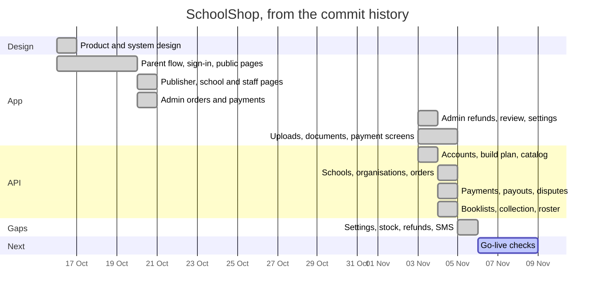
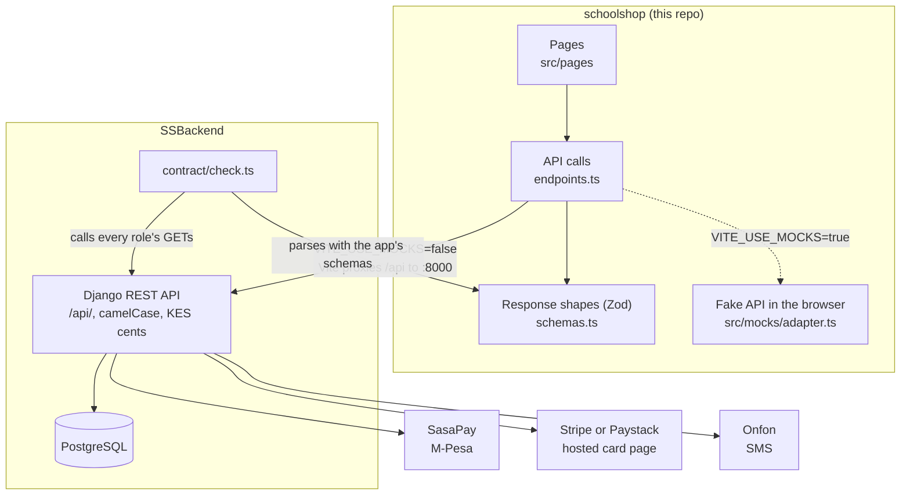
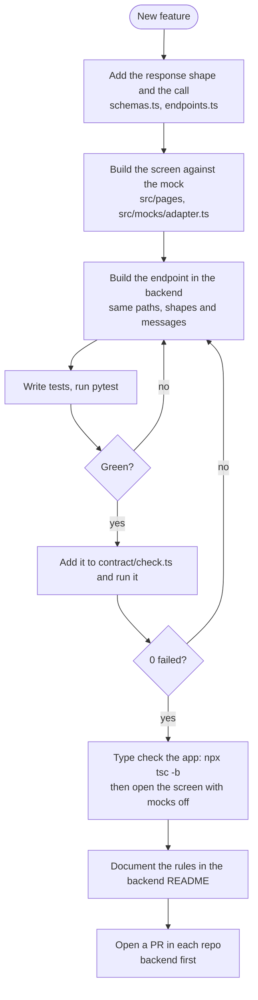
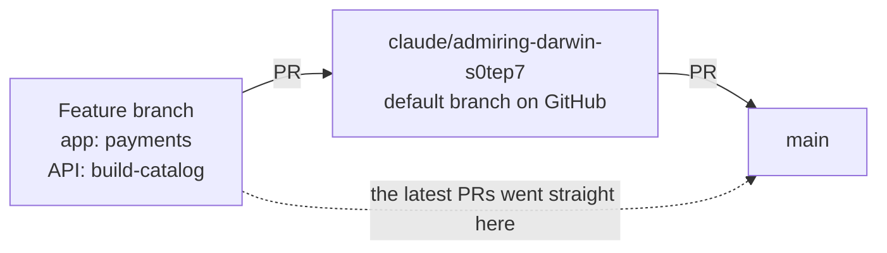
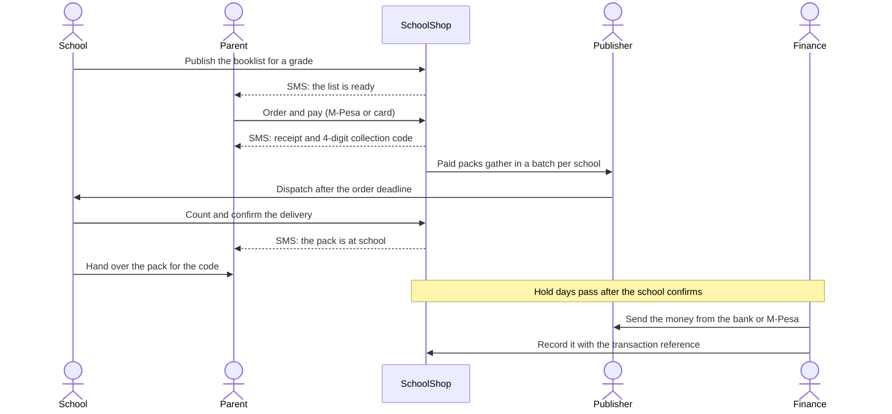
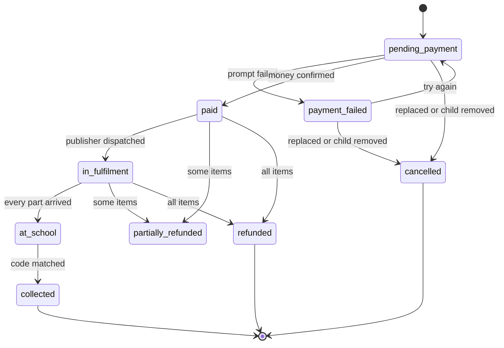
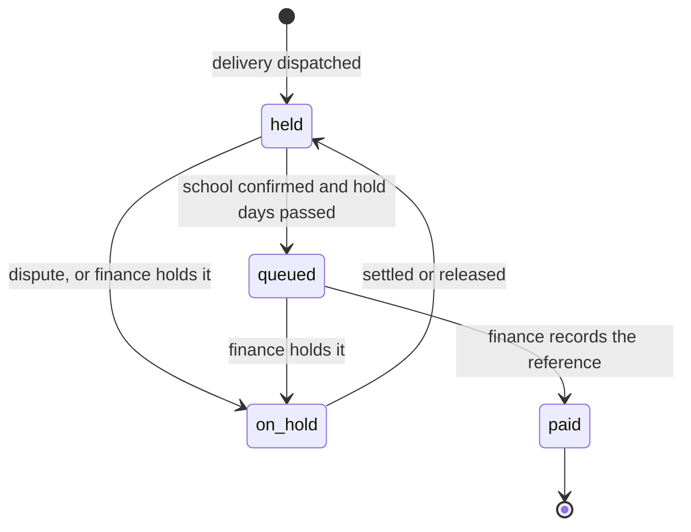
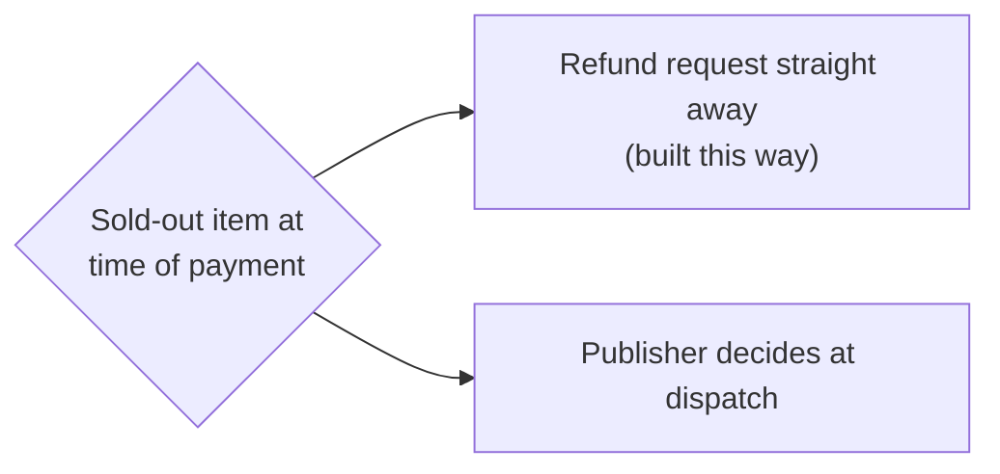

# SchoolShop

E-commerce for school materials in Kenya, with three sides:

- **Parents** buy their child's school booklist and pay with M-Pesa or card.
- **Schools** publish what each grade needs and receive the deliveries.
- **Publishers** supply the materials, delivered in bulk to each school.

SchoolShop staff run it from an admin area. This repo is the React app. The API is in [`serenade18/SSBackend`](https://github.com/serenade18/SSBackend).

**New to the project?** Read the map below from top to bottom. It shows how the project was built, where it stands and what's left. Then run it with [Run it in 5 minutes](#run-it-in-5-minutes).

## The project at a glance

```mermaid
flowchart LR
    A["1. Design<br/>docs/DESIGN.md"]:::done --> B["2. App on a fake API<br/>src/mocks"]:::done
    B --> C["3. The contract<br/>schemas.ts + mock"]:::done
    C --> D["4. Real API<br/>SSBackend"]:::done
    D --> E["5. Test<br/>pytest + contract check"]:::partly
    E --> F["6. Close the gaps<br/>settings, stock, SMS"]:::done
    F --> G["7. Go-live checks"]:::todo
    G --> H["8. Deploy"]:::todo
    H --> I["9. Run and improve"]:::todo

    classDef done fill:#d1f2e0,stroke:#1a7f4b,color:#0b3d23
    classDef partly fill:#fff1c9,stroke:#b58900,color:#4d3a00
    classDef todo fill:#eceff3,stroke:#7a8594,color:#2b3440
```



Green is done, yellow is partly done, grey is not started. **We are at step 7.**

| Step | What happened | When | Where to read |
| --- | --- | --- | --- |
| 1. Design | Product, flows, data model, money flow and brand | 16 Oct 2026 | [`docs/DESIGN.md`](docs/DESIGN.md), [`docs/brand/`](docs/brand/) |
| 2. App on a fake API | Every screen for every role, answered in the browser by a mock | 16 Oct – 3 Nov | [`src/pages/`](src/pages/), [`src/mocks/adapter.ts`](src/mocks/adapter.ts) |
| 3. The contract | The mock and its response shapes became the specification for the API | Throughout step 2 | [`src/lib/api/schemas.ts`](src/lib/api/schemas.ts), [`src/lib/api/endpoints.ts`](src/lib/api/endpoints.ts) |
| 4. Real API | Django apps built in the plan's phases | 3 – 4 Nov | Backend `BUILD_PLAN.md` and `README.md` |
| 5. Test | Backend tests and a live contract check. **Missing:** a recorded click-through of the whole app, app tests and CI | 3 – 5 Nov | Backend `apps/*/tests/`, `contract/check.ts` |
| 6. Close the gaps | School settings, stock, parents' refunds, Onfon SMS | 5 Nov | Backend `README.md` |
| 7. Go-live checks | See [What's left](#whats-left) | **Now** | This page |

## Timeline



## How the two repos fit together

The app is the specification. The backend was built to match it, and a script proves the two still agree.



**Rule when they disagree:** the app wins. Don't bend the app's contract to make the backend easier. If the mock has no answer, pick the simplest rule that keeps money safe and write it in the backend README.

## How a feature gets built

Follow this loop for new work. It's how the existing features were built.



## How code reaches `main`



- There's no CI in either repo, so run the checks yourself before merging.
- In both repos the latest work reached `main` directly, so `main` is ahead of the default branch `claude/admiring-darwin-s0tep7`. Agree on one path with the repo owner.

## What the product does

One term, from a school's list to the publisher's money:



An order's states. Any paid order can also be partly or fully refunded along the way:



A publisher's payout. SchoolShop never sends it automatically:



## Decisions already made

Please don't reverse these without asking the repo owner.

| Decision | Why |
| --- | --- |
| M-Pesa goes through SasaPay, not Daraja | The owner's choice. The field names in its callback came from third-party clients, so check them on the sandbox |
| Cards use Stripe's or Paystack's hosted page | Card details never reach SchoolShop |
| Provider keys are entered in the admin and encrypted | Keys are managed without touching the server's settings |
| Publisher payouts can be automatic to verified M-Pesa mobile accounts through SasaPay, or manual for bank, Paybill, and Till accounts | Automated transfers require a provider-confirmed result; other payout account types remain under finance control |
| A dispute refunds only the students staff tick | Schools count per class, so refunding a whole short class would over-refund |
| No commission on refunded money | A deliberate change from the mock |
| SMS goes through Onfon | The owner already uses it |
| No server-side cart or inventory app | The basket lives in the browser, and stock lives on the product |

## What's left

### Decisions for the repo owner



Payout automation is available for verified M-Pesa mobile accounts via SasaPay; bank, Paybill, and Till payouts remain manual. Settle the sold-out question before launch, because it decides whether parents get refunded automatically.

### Checks before launch

- [ ] Send a real text through Onfon. It has only been tested against a stand-in, and its docs don't state the phone format.
- [ ] Try SasaPay on its sandbox: parent payments, refunds, and automatic M-Pesa mobile payouts including callbacks.
- [ ] Run the tests and the contract check on PostgreSQL. The latest run used SQLite, so row locking hasn't been tested.
- [ ] Click through every role with mocks off, then run a whole term end to end. The steps are in the backend's `BUILD_PLAN.md`, phase 5.
- [ ] Open the new parent screens in a browser: the refund request form and downloads.
- [ ] Check publishers' stock figures. A live title at 0 creates a refund request for everyone who pays for it.
- [ ] Add CI to run `pytest`, the contract check and the app's type check.
- [ ] Add a test for the admin's organisation document download. The demo has no uploaded files, so the contract check skips it.

### Deploying

Neither repo has deployment config yet, so step 8 still has to be written down. It will need:

- the app's `.env` pointing at the live API;
- `orders` and the other migrations run;
- `FIELD_ENCRYPTION_KEY`, `PUBLIC_API_URL`, `SMS_BACKEND=onfon` and the `ONFON_*` keys set;
- provider webhooks added, as the backend README explains;
- `python manage.py send_order_reminders` scheduled daily;
- `python manage.py auto_release_payouts` scheduled daily if automatic payouts are enabled.

## Run it in 5 minutes

**Just the app, on the fake API:**

```bash
npm install
VITE_USE_MOCKS=true npm run dev     # http://localhost:5173
```

Every one-time code in this mode is `123456`.

**The app on the real API.** Clone both repos side by side, then:

```bash
# In SSBackend
python3 -m venv .venv && . .venv/bin/activate
pip install -r requirements.txt
cp .env.example .env                # then set your own values
createdb schoolshop
python manage.py migrate
python manage.py seed_demo
PAYMENTS_GATEWAY=fake OTP_FIXED_CODE=123456 python manage.py runserver 8000

# In schoolshop
npm install
VITE_USE_MOCKS=false npm run dev
```

With `PAYMENTS_GATEWAY=fake` no money moves. An M-Pesa number ending in `000` fails with insufficient funds.

**Check your work:**

```bash
# In SSBackend
pytest
node contract/check.ts              # server running on the seeded demo; must print 0 failed

# In schoolshop
npx tsc -b && npm run lint
```

### Demo accounts

The password for all of them is `schoolshop1`.

| Side | Role | Phone |
| --- | --- | --- |
| Parent | Parent | 0712 345 678 |
| School | Admin | 0722 000 111 |
| School | Bursar | 0711 908 765 |
| School | Teacher | 0733 200 411 |
| Publisher | Admin | 0700 000 444 |
| Publisher | Warehouse | 0711 222 333 |
| Publisher | Finance | 0700 000 445 |
| SchoolShop | Super admin | 0799 000 999 |
| SchoolShop | Finance | 0799 000 111 |
| SchoolShop | Support | 0799 000 222 |

## Where things are

| You want to change | Look in |
| --- | --- |
| A screen | `src/pages/<role>/` |
| An API call or response shape | `src/lib/api/endpoints.ts`, `schemas.ts`, `queries.ts` |
| Who can do what | `src/lib/access.ts` here and `apps/accounts/roles.py` in the backend. Keep them the same |
| Fake API behaviour | `src/mocks/adapter.ts`, `fixtures.ts` |
| Sign-in, roles, staff, audit, SMS | Backend `apps/accounts/` |
| Schools, booklists, students | Backend `apps/schools/` |
| Products and publishers | Backend `apps/catalog/` |
| Orders, deliveries, collection, stock | Backend `apps/orders/` |
| Payments, refunds, disputes, payouts, platform settings | Backend `apps/payments/` |
| The rule behind any endpoint | The backend's `README.md` |
